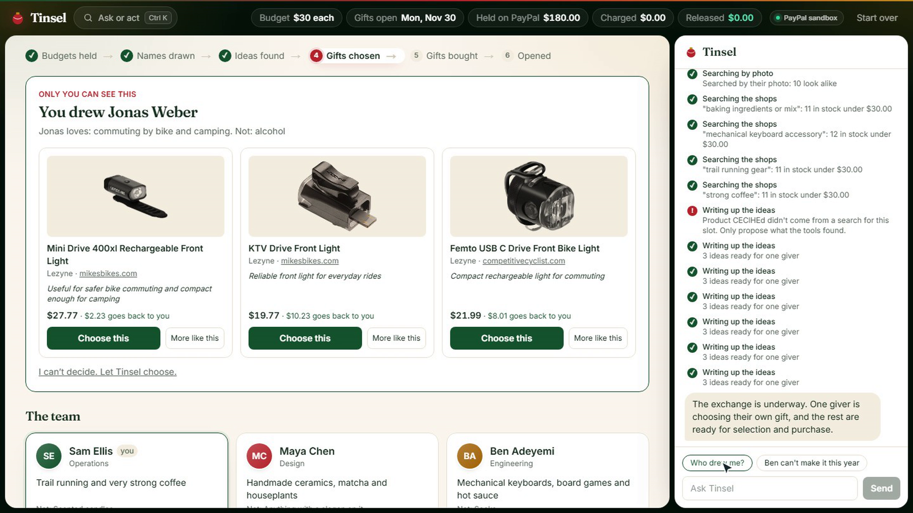
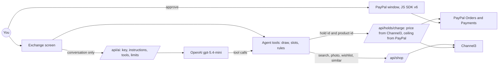

# Tinsel: the gift exchange that runs itself

**Around 2.5 million unwanted Secret Santa gifts go straight in the bin every year in the UK alone,**[^love2shop] and workmates are the top source of presents people throw away.[^hippo] Drawing names is solved. Nobody solved the rest: someone forgets, someone overspends, someone gets a mug they don't want, and the organizer spends December chasing people.

Tinsel runs the whole thing. Everyone holds their budget on PayPal. An assistant draws the names, shops real stores for each person through Channel3, and buys the gift, charging the exact price to the giver's hold and releasing the rest.

[^love2shop]: [Love2shop survey](https://workplacejournal.co.uk/?p=52726), December 2024.
[^hippo]: [HIPPO survey](https://madtechmag.com/?p=8694) of 2,000 UK adults, November 2025.

Built for the [PayPal AI Hackathon 2026](https://paypalaihackathon.devpost.com/) on the PayPal sandbox, for a fictional team, **Fernhill Studio**.

| | |
|---|---|
| Live demo | [tinsel-nine.vercel.app](https://tinsel-nine.vercel.app) |
| Demo video | _added at submission_ |
| Sandbox buyer login | in the Devpost testing instructions |



## TL;DR for judges

No sign-in. Open `/exchange`. Everything stays in your browser, and all money is PayPal sandbox money.

1. **Five colleagues place real sandbox holds** as the page opens. You're the sixth: approve yours in PayPal's window, or use the sandbox test card link to skip the sign-in.
2. **Click _Run the exchange_.** The assistant draws names, searches real products for each person, proposes three ideas each and buys for those who asked it to. You'll see your own three ideas, and only yours.
3. **Choose one.** Tinsel checks the price again and charges exactly that. Open the **PayPal ledger** to see held, charged and released amounts with PayPal's own IDs.
4. **Try to break it.** Ask _Who drew me?_ It can't know. Say _Ben can't make it this year_: his hold is released and the draw repairs itself.
5. **Open the gifts.**

## How we use PayPal

| Capability | API | Where |
|---|---|---|
| Holding a budget | **Orders v2** with the `AUTHORIZE` intent, through the **PayPal Server SDK** (`createOrder`, `authorizeOrder`) | `lib/paypal.ts`, `app/api/holds` |
| Your approval | **PayPal JavaScript SDK v6**, PayPal's own button and window | `app/exchange/paypal-hold-button.tsx` |
| Charging the exact price | **Payments v2** `captureAuthorizedPayment`, partial, with `finalCapture: true`, which releases the rest | `lib/paypal.ts`, `app/api/holds/charge` |
| Giving it all back | **Payments v2** `voidPayment`, when someone drops out or the exchange is cancelled | `lib/paypal.ts`, `app/api/holds/release` |
| Never charging twice | A `PayPal-Request-Id` per capture, so a retry returns the first result | `lib/paypal.ts` |

**The hold is a ceiling that PayPal enforces.** We tried: a $500 capture on a $3 hold comes back `422 MAX_CAPTURE_AMOUNT_EXCEEDED`. Neither the page nor the model can name an amount: the charge route takes the price from Channel3 at that moment and refuses a hold that can't cover it.

The demo's colleagues aren't there to click, so their holds use PayPal's published sandbox test card. They are real authorizations, captured and voided like yours.

## How we use Channel3

Every gift comes from Channel3's catalog, through `lib/channel3.ts`:

| Endpoint | What for |
|---|---|
| `POST /v1/search`, agentic mode | Searching from what someone loves, filtered to in stock, new and under budget |
| `POST /v1/search` with an image | Finding things like the photo someone shared |
| `POST /v1/lookup` | Reading a wishlist link someone pasted, and showing if it fits the budget |
| `POST /v1/similar` | *More like this*, and finding alternatives when a wishlist item is over budget |
| `GET /v1/products/{id}` | Checking the price and stock again right before charging |
| `POST /experimental/sticker` | Cut-out pictures for the moment a gift is opened |

Each product comes down to its cheapest offer that's in stock, new and in dollars, so a product nobody can sell never reaches the screen or the model.

## How we use AI

- **Model:** OpenAI `gpt-5.4-mini`, through a server proxy (`app/api/ai`) that holds the key, only serves this site's pages, limits calls per visitor and per day (`lib/guard.ts`) and caps each answer. The browser sends only the conversation: the instructions, the tools and the model are fixed on the server (`lib/assistant.ts`).
- **Our tools** (`lib/exchange/tools.ts`), run in the browser against the exchange: `checkExchange`, `drawNames`, `searchGifts`, `searchByPhoto`, `checkWishlist`, `proposeIdeas`, `pickGift`, `buyGift`, `handleDropout`, `cancelExchange`.
- **The model decides; plain code does what must be right.** It reads tastes, writes the searches, chooses and explains. The draw, the repair after a drop-out and the checks on money are tested code (`lib/exchange/draw.ts`, `lib/charge.ts`).
- **It can't see the draw.** Tools give the model numbered slots and anonymous tastes (`anonymousRecipient` in `lib/exchange/state.ts`). The link between a slot and a name stays in the browser. Tests hold this to account.
- **It can only propose what a search returned,** only buy what was chosen, and only choose for givers who said it may.
- **If the model is unavailable,** the same tools still run the exchange, with searches taken from the words in each profile (`lib/exchange/scripted.ts`).
- **Built with AI:** the code was written with Claude Code. Changes were checked in a real browser with Playwright, and logic is covered by tests.

## Architecture



## Run it locally

You need Node.js 20.9 or later, a [PayPal developer](https://developer.paypal.com) sandbox app, a [Channel3](https://trychannel3.com/developers) API key and an OpenAI API key (optional: without one, the run without a model still works).

1. `npm install`
2. Copy `env.example` to `.env.local` and fill it in.
3. `npm run dev` and open http://localhost:3002.

## Checks

```bash
npm run lint
npm run typecheck
npm test
```

CI (`.github/workflows/ci.yml`) runs all three on every push, and a pre-push hook runs them first. `/api/health` on a running deployment says whether PayPal answers and what is configured, without showing any value.

## What it doesn't do (yet)

- **No parcel ships.** Channel3 sells through retailer links, and its own checkout hasn't shipped. In this sandbox demo the money stops at the capture. A live version would hand each order to a checkout partner, which is also what keeps a recipient's address hidden from their giver.
- It runs on the PayPal **sandbox** only.
- There is no database and no sign-in: each browser holds its own exchange, so the team is simulated. Real invitations need a server-side store.
- The hold covers the product price. A live version would hold a little more for tax and shipping, and still charge only what the gift costs.
- Someone can't drop out once their gift, or the gift for them, has been bought. That needs a refund flow.
- The public demo limits the assistant, the searches and the holds per day. When a limit is reached, the app says so.

## License

[MIT](LICENSE)
